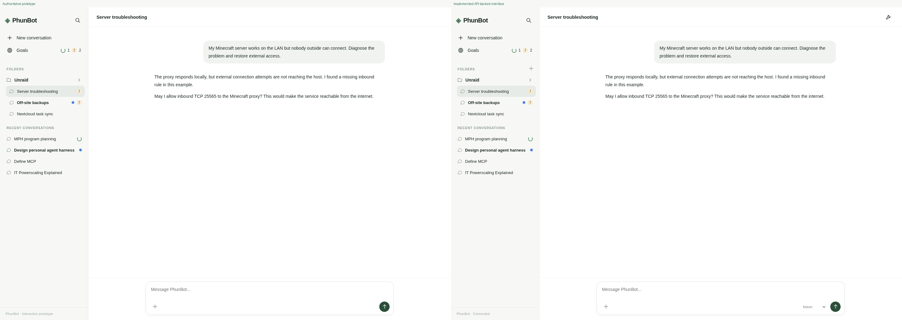
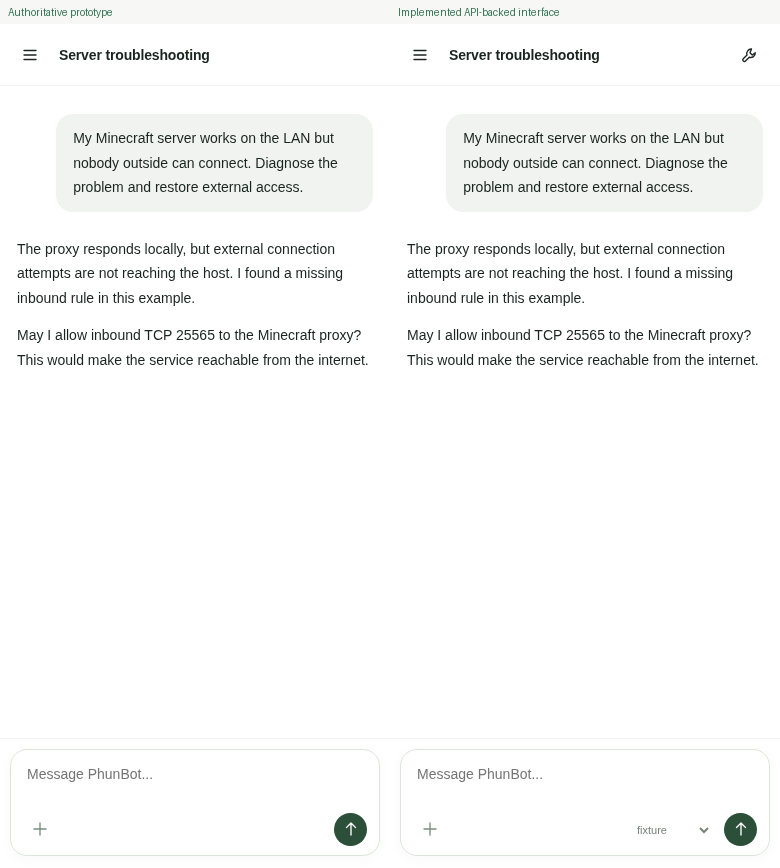
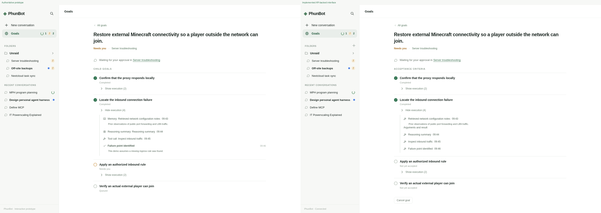

# Prototype-matched PhunBot interface

## Scope and identity

This is a development UI candidate stacked on memory telemetry PR #2, which is
stacked on architecture PR #1. Its base is
`b05531a6135f4d60e8aefae80811dbd8042ffe57`.
It is not a production deployment or release acceptance receipt.

The supplied HTML is the specification, not inspiration. Its exact bytes are
retained in `src/test/fixtures/prototype-ui.html` for repeatable comparison:

```text
SHA-256: 043ea81c9f0a7cb1082cf802cd1727117e02b7dc48632dcc8153f36eff6e44bd
```

The original was run and reference screenshots were captured before application
edits. Its CSS remains an unchanged prefix of `src/ui.css`; production-only
rules follow that prefix. The SVG symbols, page structure, spacing, colors,
sidebar, composer, filters, and mobile breakpoints come from the original.
Inline handlers were replaced with event listeners, and inline style declarations
were moved into the stylesheet to preserve the existing Content Security Policy.
The internal prototype title says v6; the supplied v7 file was not silently
renamed or corrected.

The tested source manifest and suite receipts are in
[ui-evidence/source-manifest.json](ui-evidence/source-manifest.json) and
[ui-evidence/test-results.json](ui-evidence/test-results.json). The final Git
commit is identified by the pull request head; the manifest avoids a circular
self-referential commit field.

## Browser comparison

Original and implemented pages ran in the same Chromium build, at desktop
**1440×1000** and mobile **390×844**, with reduced motion enabled. The implemented
page uses the actual application HTTP server, canonical Pi SessionManager
histories, and explicitly synthetic Nextcloud/model fixtures. The frontend does
not replace API calls with canned responses. A held execution produces the
working indicator; it is not inferred from a persisted `running` string.

The conversation app/sidebar/message/user-bubble/composer rectangles match the
original exactly on desktop; message/user-bubble/composer rectangles also match
exactly on mobile. These are asserted by the browser test, not estimated from
screenshots. See [browser-results.json](ui-evidence/browser-results.json).

| View | Side-by-side evidence | Changed pixels, threshold >8/channel |
| --- | --- | ---: |
| Desktop conversation | [comparison](ui-evidence/comparison-desktop-conversation.png) | 0.0559% |
| Mobile conversation | [comparison](ui-evidence/comparison-mobile-conversation.png) | 0.0799% |
| Mobile sidebar | [comparison](ui-evidence/comparison-mobile-sidebar.png) | 0.1944% |
| Global Goals | [comparison](ui-evidence/comparison-desktop-goals.png) | 0.0713% |
| Individual goal | [comparison](ui-evidence/comparison-desktop-goal.png) | 0.1891% |
| Expanded execution | [comparison](ui-evidence/comparison-desktop-events.png) | 1.5474% |

These percentages count changed pixels across the entire viewport; they are
**not** a perceptual similarity score or a pixel-perfect claim. The larger
execution difference reflects real event contents and truthful criterion state.
Both separate originals and implementation images accompany every comparison.
The paired images were inspected directly, not accepted from metrics alone.







## Mapping to the existing backend

- **Conversations:** canonical Pi history is projected through the existing
  `conversationMessages`/`projectConversation` boundary. User/assistant text stays
  readable. Tool calls and visible execution messages are separate disclosures,
  closed by default. Provider thinking is excluded.
- **Goals:** Nextcloud remains the source of persistent goals and child
  acceptance criteria. The UI neither writes a parallel browser goal database
  nor derives successful verification from assistant prose.
- **Activity now:** `liveExecution` is an application-runtime observation, scoped
  to the exact active goal, distinct from `persistentStatus` and scheduled retry
  metadata. A stale persisted `running` label cannot create a spinner. Separate
  conversations can display simultaneous execution.
- **Acceptance:** the existing Controller acceptance receipt determines a
  completed criterion. A provisional `COMPLETED` child without its accepted
  parent receipt remains **Not yet accepted**.
- **Children and history:** actual goal parent links, when present, produce
  navigable child-goal rows. Criteria are not relabeled as independent goals.
  Execution observations are associated with a criterion only through explicit
  evidence IDs or task/criterion IDs. Unassociated observations remain in the
  goal's execution history. Long histories are bounded and paginated, not silently
  dropped.
- **Organization:** folders and conversation membership are server-persisted.
  Existing catalog folder names are adopted without copying local browser state.
  Folder creation, rename, deletion, and conversation moves use authenticated APIs.
  Nonempty deletion, duplicate names, cycles, invalid parents, corrupt state, and
  private-file boundary violations are rejected.
- **Unread:** a read marker stores only the exact visible Pi response identity
  in conversation metadata. New responses invalidate older acknowledgements;
  thinking-only turns do not manufacture unread assistant messages.
- **Browser storage:** the existing session-scoped access token and hashed
  pending-admission identity remain. Transcript and goal state are not copied to
  localStorage. Composer drafts are transient in-memory input, not canonical
  session history. URL fragments identify the current view across refreshes.
- **Memory:** PR #2 telemetry and the memory/retrieval/review implementations are
  unchanged by this UI branch.

## Disclosed visual and behavioral differences

These are backend/safety mappings and retained production capabilities, not an
independent redesign:

1. The prototype's **Child goals** example rows map to the existing model's
   **Acceptance criteria**. Unverified criteria are neutral and **Not yet
   accepted**; the UI does not invent per-child working/blocked/queued state.
   Actual child-goal records are shown separately when they exist.
2. Execution disclosures contain real recorded tool names, observed timestamps,
   redacted summaries, and a second collapsed **Arguments and result** disclosure.
   Synthetic reasoning/memory categories are not invented for real events, and
   private provider reasoning is never exposed. This changes expanded-row text,
   icon selection, and height relative to the hardcoded example.
3. Login, the existing model selector, conversation rename/move, folder-management
   affordances, hover/focus copy controls, and the actual Cancel goal action are
   functional production controls. They do not change the main layout geometry.
   An additional Cancelled filter exposes the real terminal state. The footer no
   longer calls the application an interactive prototype.
4. The existing validation-history default is retained. A checkbox in Search can
   reveal validation conversations; ordinary conversation lists hide them by
   default. This is a display preference, not an access-control boundary.
5. Privileged approval uses the existing **separate owner command**, with a copy
   control and exact request identity. There is no misleading browser Approve
   button: an ordinary conversation bearer cannot supply a signed owner proof.
   A pending operation can be denied from its exact goal.
6. The prototype's demo transitions and text-regex simulation logic are not
   copied into the browser. Messages go through real durable admission and the
   existing agent/controller. Text such as pause/redirect is not used by the
   browser to rewrite authoritative goals. The Paused filter is a view, not a new
   pause-management subsystem; it is empty if the backend has no paused goals.
   No simulated firewall, backup, service-recovery, or completion controls remain.
7. The demo implies authorization in chat can directly permit a consequential
   operation. The real interface deliberately retains the stronger independent
   owner-authorization boundary instead.

## New authenticated API reads and organization metadata

All routes remain under the existing bearer and same-origin checks.

| Route | Purpose |
| --- | --- |
| `GET /api/ui/goals` | Authoritative persistent goal projection, exact live execution, criteria, children, compact history, blockers, authorization requests |
| `GET /api/ui/goals/:id/history?expand=1&limit=100&offset=0` | Bounded redacted observations; `count`, `hasMore`, and `nextOffset` describe pagination |
| `GET /api/search?q=...` | Conversation titles/visible canonical messages and goal titles; no provider thinking; at most 15 results |
| `GET/POST /api/folders` | List or create persisted folders |
| `PATCH/DELETE /api/folders/:id` | Validated rename/parent move or empty-folder deletion |
| `PATCH /api/sessions/:id` with `folderId` | Persist conversation membership; `null` returns it to Recent |
| `POST /api/sessions/:id/read` with `responseId` | Exact-response read acknowledgement; stale identity returns 409 |

Existing send, model selection, cancellation, and authorization endpoints retain
their existing controllers. No new daemon, service, proxy, scheduler, or n8n
workflow is introduced.

## Verification

| Check | Result |
| --- | --- |
| Application suite, including memory, telemetry, controller, queue, permissions, privacy, and new UI API tests | 226 passed, 0 failed |
| Vendored AMP suite | 35 passed, 0 failed |
| AMP TypeScript build | Passed |
| Native Pi fault/restart integration | 3 checks passed |
| Prototype comparison and functional browser integration | 20 checks passed |
| Existing browser acceptance, selectors migrated to the prototype layout without dropping behavioral checks | 20 checks passed |
| Static browser initialization without API responses | 5 checks passed |
| Separate targeted clipboard-fallback execution with actual clipboard readback | 3 checks passed |
| Syntax and `git diff --check` | Passed |

Browser coverage includes concurrent held goals, persistent/live status
separation, real admission and cancellation, model changes, image delivery and
canonical rendering, folders, search, nested tool expansion, refresh, delayed
navigation responses, touch navigation, and rejected ordinary-bearer approvals.
The older acceptance suite also checks Markdown/table/code rendering, sanitized
HTML, copying, provisional verification, hidden validation history, and reusing
one request/goal after an admitted response is lost across a reload.

Reproduce from `src/` after installing the locked dependencies:

```sh
npm test
npm test --prefix vendor/amp
npm run build --prefix vendor/amp
node integration/native-faults.mjs
node browser/acceptance.mjs
node test_ui.mjs
node integration/ui-browser.mjs
uv run --with pillow python integration/ui-compare.py
```

Install Playwright Chromium first. A preinstalled compatible browser can be
selected with `PHUNBOT_CHROMIUM` for the existing browser/smoke suites and
`CHROMIUM_EXECUTABLE` for the comparison suite. Those are environment overrides,
not machine-specific source paths.

## Remaining release boundaries

No unresolved blocker was found in the [independent review](ui-evidence/independent-review.json). A nonblocking coverage suggestion remains: retain the separately verified clipboard fallback as a permanent regression test. The tests
are controlled-fixture evidence, not a claim that live providers, production
Nextcloud, AMP targets, or production n8n were exercised. Other browser engines,
physical mobile devices, deployment, exact-source live correspondence, and
production rollback remain separate release gates. No production changes,
service restarts, workflow activation, PR merges, or deployment were performed.
